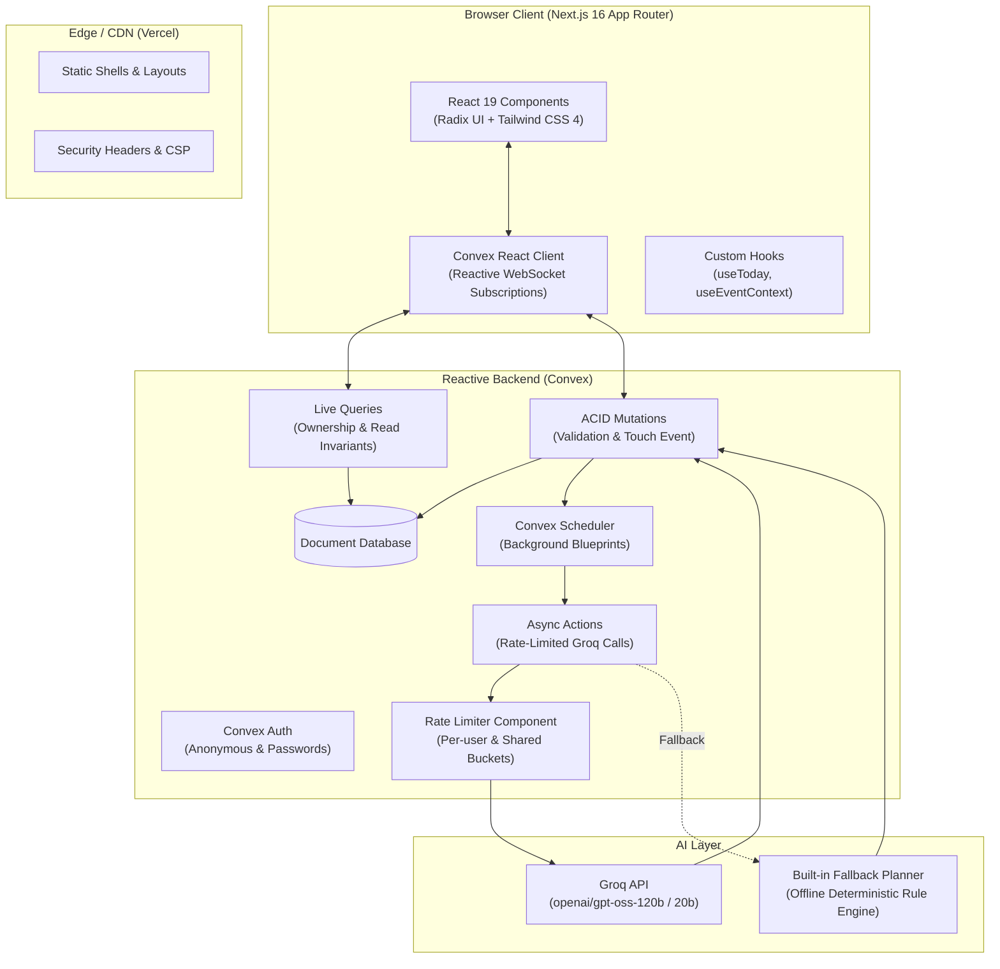

# System Architecture

This document outlines the architectural principles, component boundaries, and structural patterns governing Festa.

---

## 1. High-Level System Architecture

Festa is designed as a reactive, offline-resilient, type-safe full-stack application. It cleanly separates pure domain arithmetic from network state, and keeps AI models behind strict JSON schemas and validation barriers.

---

## 2. Layered Separation of Concerns

The codebase is strictly structured into three distinct layers with unidirectional dependencies:

| Layer                     | Directory             | Responsibilities & Invariants                                                                                                                                                                                                                                      |
| :------------------------ | :-------------------- | :----------------------------------------------------------------------------------------------------------------------------------------------------------------------------------------------------------------------------------------------------------------- |
| **Domain Logic**          | `lib/`                | **100% Pure, Zero External I/O.** Holds mathematical and business logic: currency calculations in integer cents/paise, calendar date manipulation, task sorting/reordering, budget summarization, AI schemas, and offline concierge algorithms. Fully unit-tested. |
| **Backend & Persistence** | `convex/`             | **Reactive, Isolated, Server-Authoritative.** Manages data models, authorization boundaries (`requireOwnedEvent`, `requireOwnedDoc`), cascading deletes, per-event caps, schema validators, rate limits, and scheduling. Never trusts client input.                |
| **Presentation & UI**     | `components/`, `app/` | **Accessible, Responsive, Keyboard-Friendly.** React 19 Client Components with Radix primitives and Tailwind 4. Subscribes to live Convex queries via WebSockets; optimistic updates where applicable, zero layout shift, 0 axe-core accessibility violations.     |

---

## 3. Core Architectural Patterns

### A. Deterministic Arithmetic (ADR 1)

LLMs are non-deterministic and prone to calculation errors. To eliminate rounding drift and arithmetic hallucinations:

- The AI never calculates budget amounts; it only returns integer percentages.
- `lib/money.ts` transforms percentages into exact currency amounts using the Largest Remainder Method (`allocateByWeights`).
- All currency arithmetic is performed in minor units (integer paise / cents) via `toMinor()` and `fromMinor()`.

### B. Propose-Then-Approve Concierge (ADR 2)

The AI Concierge acts as an advisor, not a direct modifier:

- The AI returns structured suggestions (`ProposedChange[]`).
- Changes are presented to the user as an interactive proposal preview card.
- Mutations are applied to database state only when the user explicitly approves individual or all adjustments.
- Server re-validates all values and constraints before applying.

### C. Graceful Degradation & Built-in Offline Fallback (ADR 3)

Festa operates reliably even if third-party AI APIs fail, hit rate limits, or are unconfigured:

- In the absence of a `GROQ_API_KEY`, rate-limiting (429), or malformed output, the system transparently falls back to `lib/plan/template.ts` and `lib/concierge/fallback.ts`.
- The user is notified of the source ("built-in planner" vs "AI blueprint").

### D. Zero-Skeleton Navigation via Prewarming (ADR 4)

- When opening an event (`components/events/event-workspace.tsx`), the client subscribes to all event sections (budget, tasks, vendors, moodboard, schedule) concurrently.
- Tab transitions occur instantaneously without flash-of-loading or layout skeletons.

### E. Multitenant Security & ID Obfuscation (ADR 5 & SECURITY.md)

- User identity is always derived from the server session context (`requireUserId(ctx)`), never accepted as a client argument.
- Every entity query and mutation asserts ownership against `ownerId`.
- Guessed IDs or cross-tenant access attempts return identical "not found" errors, preventing ID enumeration.

---

## 4. Reliability & Verification Matrix

- **Unit Tests:** Pure functions in `lib/` tested via Vitest with 100% coverage.
- **Integration Tests:** Convex backend functions tested via `convex-test` across all security and boundary conditions.
- **E2E Automation:** Playwright walks critical paths (event creation, concierge chat, budget recalculation, drag-and-drop).
- **Accessibility:** Automated WCAG 2.1 AA audits via `@axe-core/playwright`.
