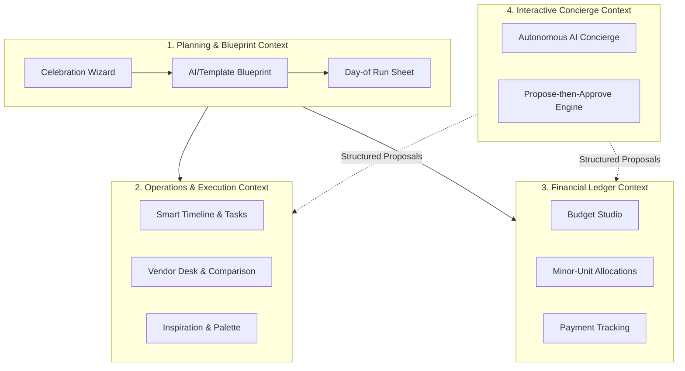
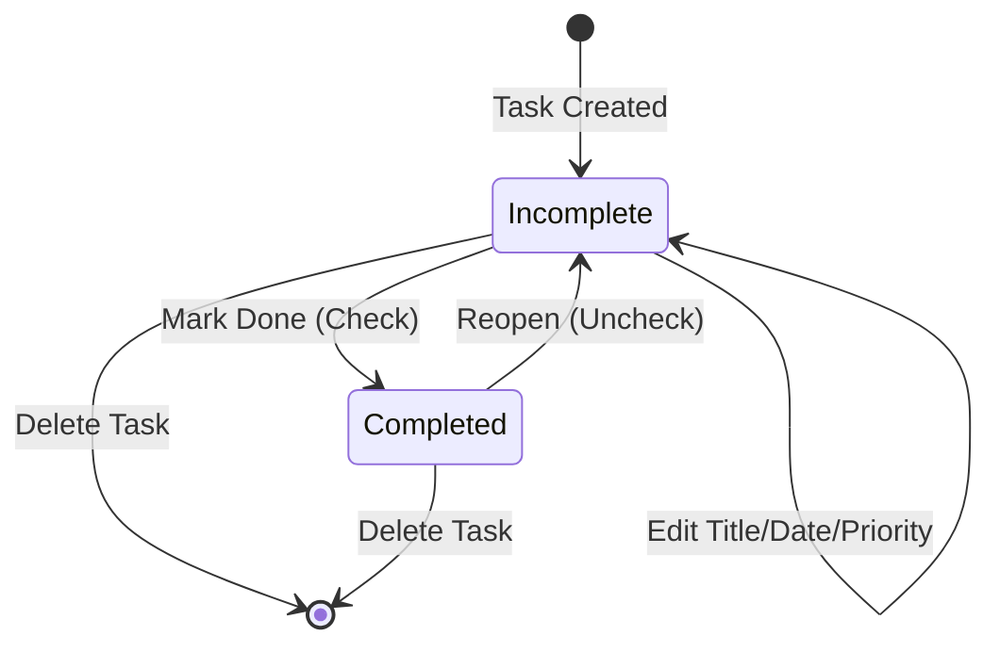
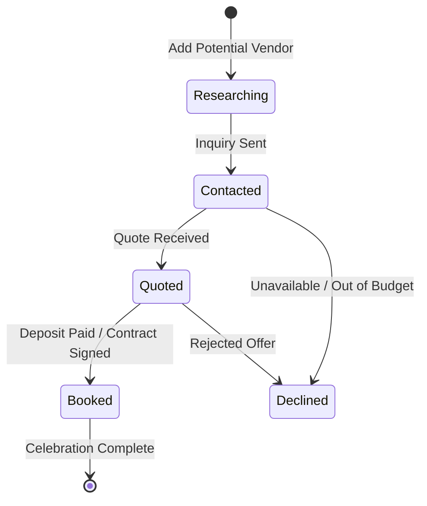
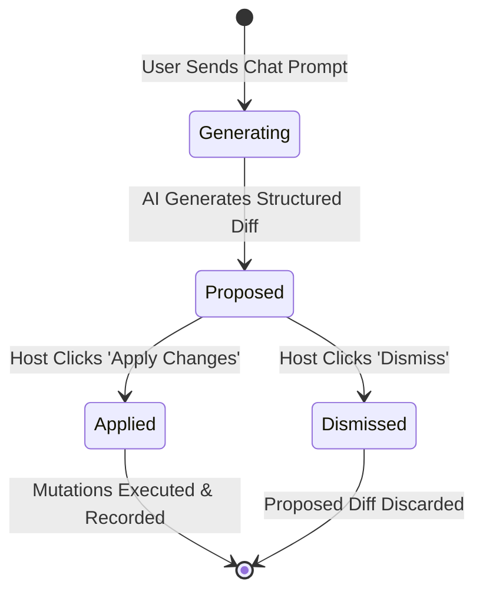

# Festa Domain Model & Ubiquitous Language

This document defines the core domain model, ubiquitous language, bounded contexts, entity invariants, and state transitions for **Festa**. All contributors and Google Antigravity agents must adhere strictly to these domain concepts.

---

## 1. Domain Overview & Bounded Contexts

Festa is an intelligent celebration planner engineered to eliminate spreadsheet chaos when organizing high-stakes personal and community events (weddings, anniversaries, milestones, baby showers, dinners, and festivals).

The system decomposes into four primary Bounded Contexts:

---

## 2. Ubiquitous Language (Glossary)

### Celebration (`Event`)

The aggregate root of the planning workspace. Contains core parameters:

- `title`: Name of the celebration (e.g., "Meera & Kabir's Engagement").
- `type`: Celebration archetype (`wedding`, `birthday`, `baby_shower`, `anniversary`, `community`, `dinner`, `other`).
- `date`: ISO calendar date string (`YYYY-MM-DD`).
- `city`: Geographical locality influencing vendor recommendations, seasons, and logistics.
- `guestCount`: Expected attendee volume; scales budget estimates and run-sheet timings.
- `budget`: Total target expenditure expressed in integer major units (e.g., `500000`).
- `currency`: ISO 4217 currency code (`INR`, `USD`, `EUR`, `GBP`, `AUD`, `CAD`, `SGD`, `AED`).

### Celebration Blueprint (`Blueprint`)

The strategic masterplan drafted upon event creation. Composed of:

- **Concept & Vibe:** Narrative description setting theme, mood, and experiential vision.
- **Palette:** Color tokens (hex strings + descriptive semantic names) for visual identity.
- **Budget Split:** Recommended percentage distributions across standard categories.
- **Milestone Tasks:** Time-phased tasks relative to the celebration date.
- **Vendor Categories:** Recommended vendor disciplines to engage.
- **Risk Checklist:** Potential event-day pitfalls and mitigation contingencies.

### Budget Line (`BudgetItem`)

A granular line item in the financial ledger:

- `category`: Functional grouping (`venue`, `catering`, `decor`, `photography`, `attire`, `music`, `stationery`, `favors`, `logistics`, `contingency`).
- `name`: Description of the expenditure.
- `estimated`: Budgeted amount in major currency units.
- `actual`: Negotiated or final contracted amount (optional).
- `paid`: Cumulative funds disbursed to date.
- `status`: Payment progression: `unpaid` (0 paid), `deposit` (0 < paid < actual/estimated), `paid` (paid >= actual/estimated).

### Smart Task (`Task`)

An actionable milestone on the planning timeline:

- `title`: Action verb phrase.
- `category`: Corresponds with budget and vendor categories.
- `priority`: Urgency tier: `low`, `medium`, `high`, `urgent`.
- `dueMode`: Scheduling strategy:
  - `relative`: Calculated as `offsetDays` prior to (`-N`) or following (`+N`) the celebration date. Deadlines automatically recalculate when the event date shifts.
  - `fixed`: Hardcoded calendar date (`YYYY-MM-DD`).
  - `none`: Floating backlog item.
- `completed`: Boolean state toggle.
- `order`: Deterministic float sequence for drag-and-drop reordering.

### Day-of Run Sheet (`ScheduleItem`)

The minute-by-minute operational itinerary for event day:

- `time`: 24-hour time string (`HH:MM`).
- `title`: Phase or activity title (e.g., "Vendor Load-in & Floral Setup").
- `description`: Detailed logistics, point person, and stage requirements.
- `category`: Segment classification (`setup`, `ceremony`, `reception`, `meal`, `entertainment`, `wrapup`).

### Vendor Contact (`Vendor`)

A prospective or contracted service provider:

- `name`: Business or individual name.
- `category`: Specialization matching budget disciplines.
- `contact`: Phone number, email, or Instagram handle.
- `status`: Booking pipeline: `researching` → `contacted` → `quoted` → `booked` (or `declined`).
- `quotedAmount`: Vendor proposal quote in major currency units.
- `notes`: Deliverables, package inclusions, and payment schedules.

### Moodboard Swatch (`Inspiration`)

Visual or thematic reference assets:

- `title`: Subject description.
- `category`: Design touchpoint (`decor`, `attire`, `flowers`, `cake`, `stationery`, `lighting`).
- `color`: Hex color accent.
- `imageUrl`: Verified `https://` secure image resource.
- `notes`: Styling guidance.

### Concierge Proposal (`Proposal`)

A structured delta generated by the AI concierge in response to user requests:

- Encapsulates discrete actions: `add_task`, `add_budget_item`, `update_task`.
- **Human-in-the-Loop Barrier:** Proposals remain in `pending` state until the host explicitly clicks **Approve** or **Dismiss**.
- AI never directly mutates the database.

---

## 3. Core Invariants & Business Rules

### 1. Financial Arithmetic Invariant

- **Paise/Cent Precision:** All money math is calculated in integer minor units via `toMinor()` and `fromMinor()`.
- **Zero Floating-Point Drift:** Fractional float multiplication is strictly forbidden in ledger totals.
- **Largest Remainder Allocation:** When dividing total budget across category weight percentages, integer cents are distributed using the Largest Remainder Method (`allocateByWeights`), ensuring the sum of category budgets strictly equals the celebration budget.

### 2. Multi-Tenant Security & Ownership Invariant

- Every Convex document belongs to an authenticated user (`ownerId: v.id("users")`).
- Queries and mutations verify ownership via `requireUser()` and `requireEventOwner()`.
- Requests for unauthorized or non-existent IDs return uniform `null` or 404 responses, preventing user enumeration and timing attacks.

### 3. Resource Caps (DOS & Storage Safeguards)

Each celebration enforces hard capacity limits to ensure snappy UI rendering and prevent spam:

| Resource           | Per-Event Hard Limit | Enforcement Point           |
| :----------------- | :------------------- | :-------------------------- |
| Budget Lines       | 50 items             | `convex/lib/caps.ts`        |
| Tasks              | 80 items             | `convex/lib/caps.ts`        |
| Vendors            | 30 items             | `convex/lib/caps.ts`        |
| Moodboard Swatches | 40 items             | `convex/lib/caps.ts`        |
| Run Sheet Items    | 30 items             | `convex/schedule.ts`        |
| Concierge Messages | 50 messages          | Rate-limited sliding window |

### 4. Deterministic Offline Fallback

- If the Groq API key is absent, rate-limited (HTTP 429), or returns schema violations:
  - Blueprint pipeline falls back immediately to `templateBlueprint()`.
  - Concierge falls back immediately to `fallbackConcierge()`.
- The user is notified transparently with an inline badge; zero workflows are blocked.

---

## 4. Entity State Transitions

### Task State Machine

### Vendor Booking Pipeline

### Concierge Proposal Lifecycle

