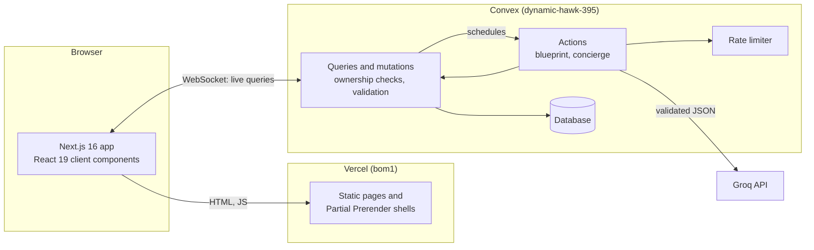

# Festa: plan the celebration, not the spreadsheet

[](https://github.com/Kirito0088/Festa/actions/workflows/ci.yml)

**Live app:** https://festa-ten-blush.vercel.app. Click **Explore the demo** to open Meera and Kabir's sample engagement in Jaipur, with no sign-up.

Festa is an AI celebration planner for weddings, engagements, birthdays, baby showers, anniversaries and community events. You answer a few questions; Festa drafts a plan you can follow and keeps it in sync as things change:

- a budget that always adds up;
- a checklist whose deadlines move with the date;
- a run sheet for the day itself;
- the vendors to call, and the ideas you want to keep;
- a concierge that proposes changes when the budget or the guest list moves.

Built for **PromptWars Virtual, Challenge 5: Celebration & Event Planner**.

## How Festa answers the brief

| The brief asks for                                                                                           | Where it lives in Festa                                                                                                                                                                                                                                                                                                                     |
| ------------------------------------------------------------------------------------------------------------ | ------------------------------------------------------------------------------------------------------------------------------------------------------------------------------------------------------------------------------------------------------------------------------------------------------------------------------------------- |
| A budget split across categories, with AI estimates labelled as estimates                                    | **Blueprint** suggests a split; **Budget Studio** turns it into lines with estimates, actuals, deposits and payments, a category chart and overspend warnings. Every figure is computed in code ([ADR 1](docs/adr/0001-money-in-code-not-in-the-model.md)).                                                                                 |
| A timeline with deadlines, reminders, completion tracking, priorities and a countdown                        | **Timeline**: deadlines counted back from the day (they move when the date moves), priorities, filters, drag-and-drop ordering, a reminder button per task (Google Calendar) and a **Calendar reminders** download (`.ics` for any calendar, with an alert the evening before each task). The countdown postmark sits on every celebration. |
| A day-of-event schedule                                                                                      | **On the day**, on the Timeline tab: an editable run sheet drafted from the celebration's type, activities and guest count.                                                                                                                                                                                                                 |
| A vendor checklist with contacts and pending or confirmed status                                             | **Vendors**: categories suggested by the blueprint, contacts, quotes, status from researching to booked, payment status and side-by-side comparison. Festa never invents real businesses; demo vendors are labelled samples.                                                                                                                |
| Personalised ideas by type, budget, guests, preferences and dietary needs, refined through follow-up prompts | **Blueprint** (concept, palette, budget split, tasks, vendors to book, risks) from an 8-step wizard; the **Inspiration** board; the **Concierge**, which refines the plan in conversation and proposes changes you approve.                                                                                                                 |

## How the AI is used

Full prompt specifications, safety guardrails, structured JSON schemas, and anti-hallucination invariants are detailed in [PROMPTS.md](PROMPTS.md).

- **Blueprint generation.** Groq's `openai/gpt-oss-120b` (falling back to `openai/gpt-oss-20b`) drafts the concept, palette, budget percentages, dated tasks, vendor categories and risks. It is called from a Convex action with a strict JSON schema, and the output is validated with Zod before anything is saved.
- **The concierge.** It reads the saved plan and answers in structured JSON. Its proposed edits are stored as a proposal and applied only on approval, after the server re-validates them ([ADR 2](docs/adr/0002-concierge-proposes-the-user-approves.md)).
- **What the AI never does.** The model never does arithmetic. It returns percentages, and `lib/money.ts` turns them into exact amounts.
- **When AI isn't available.** If the key is missing, the free tier is busy or the output fails validation, a built-in planner and an offline concierge take over. The UI always says which one answered ([ADR 3](docs/adr/0003-built-in-planner-as-ai-fallback.md)).

## Architecture



- **`lib/`** holds pure, unit-tested domain logic shared by Convex and the UI: money, budget, dates, tasks, the run sheet, calendar files, AI schemas and the Groq client, the built-in planner and the concierge.
- **`convex/`** holds the schema, access helpers (`lib/access.ts`), input validation (`lib/input.ts`), rate limits (`lib/rateLimits.ts`), one module per feature, plan generation (`plans.ts`) and the concierge (`concierge.ts`).
- **`components/`** holds the UI by feature. `components/events/event-workspace.tsx` subscribes to every section's data when an event opens, so tabs switch without waiting ([ADR 4](docs/adr/0004-warm-every-section-on-event-open.md)).
- **`docs/adr/`** records the decisions behind the design.

**Stack:**

- Next.js 16 (App Router, Cache Components), React 19 and strict TypeScript.
- Tailwind CSS 4, Radix primitives and Motion.
- Convex: database, functions, scheduler, Convex Auth and the rate-limiter component.
- Groq, Zod, React Hook Form, Recharts, dnd-kit and date-fns.
- Vitest with convex-test.

## Quality

**Code Quality.** Details and engineering standards are in [CODE_QUALITY.md](CODE_QUALITY.md), [ARCHITECTURE.md](ARCHITECTURE.md), and [CONTEXT.md](CONTEXT.md):

- Engineered and verified using **Google Antigravity 2.0** with specialized custom agent auto-routing ([AGENTS.md](AGENTS.md)).
- Strict TypeScript with zero `any` types and exhaustive null safety across the entire application.
- Clean architectural boundaries: 100% pure, side-effect-free domain arithmetic in `lib/`, reactive server-authoritative mutations in `convex/`, and accessible UI components in `components/`.
- Domain-Driven Design with formal ubiquitous language and invariants ([CONTEXT.md](CONTEXT.md)).
- Prompt engineering architecture with strict JSON schemas, XML boundaries, and anti-hallucination barriers ([PROMPTS.md](PROMPTS.md)).
- Comprehensive TSDoc annotations on all exported utilities, functions, and data schemas.
- Rigorous automated verification pipeline: `npm run check` runs type checking, ESLint, Prettier formatting check, and the full test suite with coverage (>96.9% line coverage).

**Security.** Details are in [SECURITY.md](SECURITY.md):

- Secrets live only in Convex environment variables.
- Every function derives the user from the session and checks ownership.
- Inputs are validated on the server, and AI output is schema-validated.
- Per-user and shared rate limits cover AI and writes.
- The site sends a strict set of security headers, including a CSP.

**Accessibility.**

- WCAG 2.1 AA, checked with axe-core on every screen: 0 violations.
- Semantic landmarks and a skip link.
- Labelled fields with associated errors.
- Full keyboard support, including drag-and-drop reordering.
- Visible focus rings and AA contrast. The budget chart's colours were validated, and it ships a legend, tooltips and the ledger table as a text equivalent.
- With reduced motion turned on, the landing story becomes still frames and confetti is skipped.

**Performance.**

- The landing page is static, and its LCP is the headline text: 224 ms on desktop, 1.28 s on a throttled phone.
- Event tabs switch without data skeletons.
- The heavier forms load on demand, and the budget chart draws after the page.
- Functions run in Mumbai, close to users.
- Lighthouse on the live landing page scores 100 for Performance, Accessibility, Best Practices and SEO on desktop. On a simulated slow phone it scores 91 for Performance and 100 for the rest.

**Testing.** Run `npm test` for the full suite, and `npm test -- --coverage` for v8 coverage.

- Vitest unit tests cover money, budget, dates, tasks, the run sheet, calendar files, the plan note, colour contrast, AI parsing and the concierge.
- convex-test integration tests cover authorization boundaries, validation, the plan pipeline, the concierge's approval flow, demo seeding, rate limits and the day-of schedule.
- Playwright end-to-end tests (`npm run test:e2e`) walk the main workflows on the live site: opening the demo, every section, budget validation and a new line, completing a task, the reminders download, the day-of run sheet, booking a vendor and a concierge reply. A second suite covers the landing story, reduced motion, phone width and sign-in errors.
- CI runs typecheck, lint, the format check, the tests with coverage and a production build on every push. The end-to-end suite runs nightly against production, or on demand.

## Run it locally

```bash
npm install
npx convex dev   # creates a dev deployment and writes .env.local; keep it running
npm run dev      # http://localhost:3000
```

Convex Auth needs `JWT_PRIVATE_KEY`, `JWKS` and `SITE_URL` on the Convex deployment (see the [Convex Auth manual setup](https://labs.convex.dev/auth/setup/manual)). AI is optional: without a key, the built-in planner answers.

```bash
npx convex env set GROQ_API_KEY   # paste a free Groq key when prompted
```

`.env.example` lists every variable. `npm run dev` compiles each route on first visit, so it is several times slower than the deployed app; judge speed with `npm run preview`, which builds and serves production locally.

**Scripts:**

| Script            | What it does                            |
| ----------------- | --------------------------------------- |
| `npm run check`   | Typecheck, lint, format check and tests |
| `npm test`        | Tests (`-- --coverage` for coverage)    |
| `npm run build`   | Production build                        |
| `npm run preview` | Build and serve production locally      |
| `npm run format`  | Format with Prettier                    |

## Deployment

- **Frontend:** Vercel (Hobby). `vercel.json` sets the build command with the production Convex URLs and runs functions in Mumbai (`bom1`).
- **Backend:** Convex. Deploy it with `npx convex deploy` whenever `convex/` changes ([ADR 6](docs/adr/0006-deploy-backend-from-the-cli.md)).
- **Production Convex environment:** `JWT_PRIVATE_KEY`, `JWKS`, `SITE_URL` and `GROQ_API_KEY`.

## Licence

[MIT](LICENSE)
